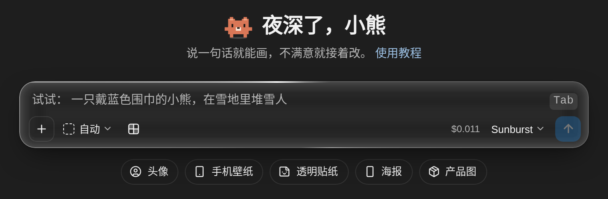
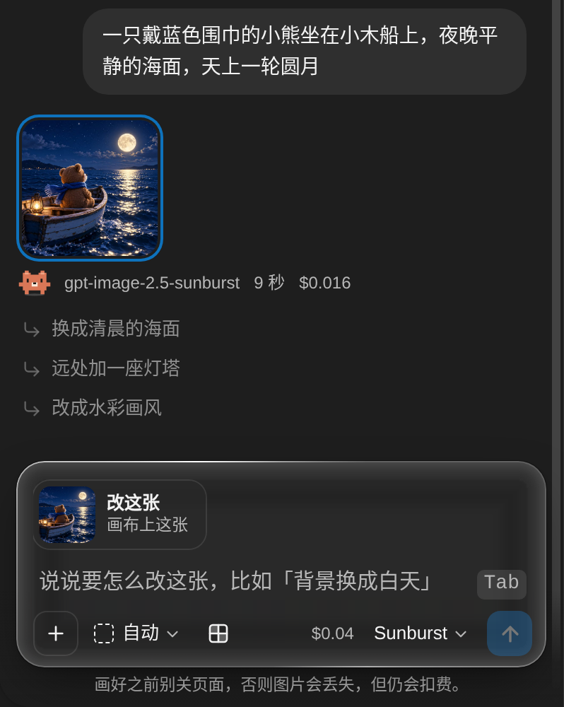
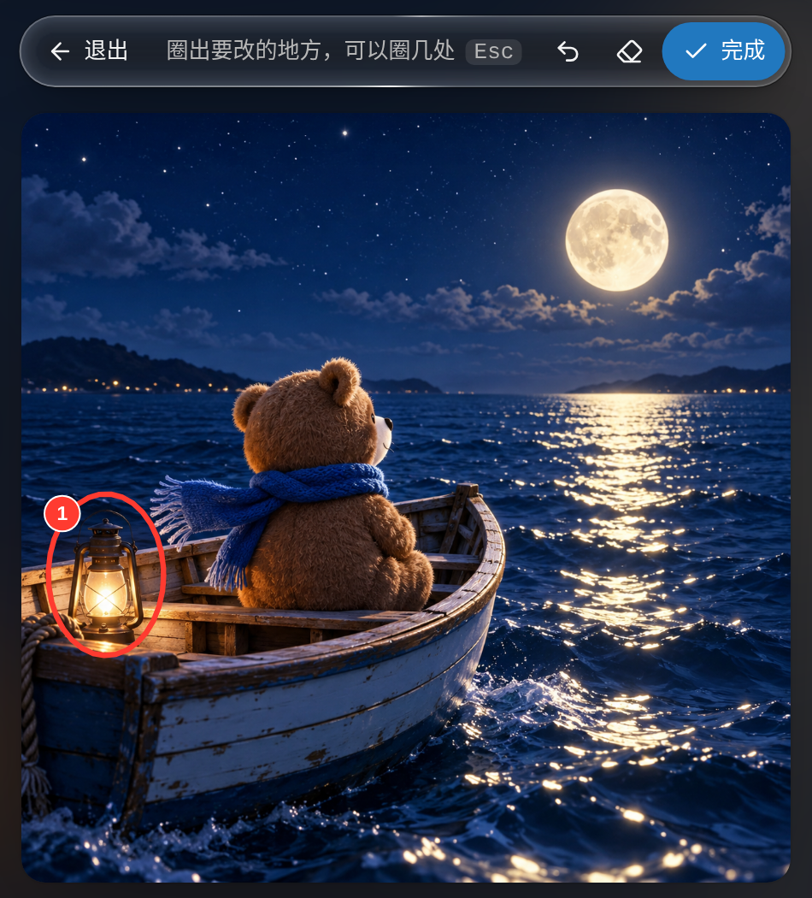
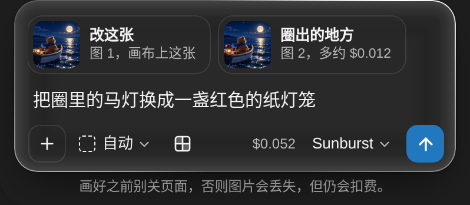
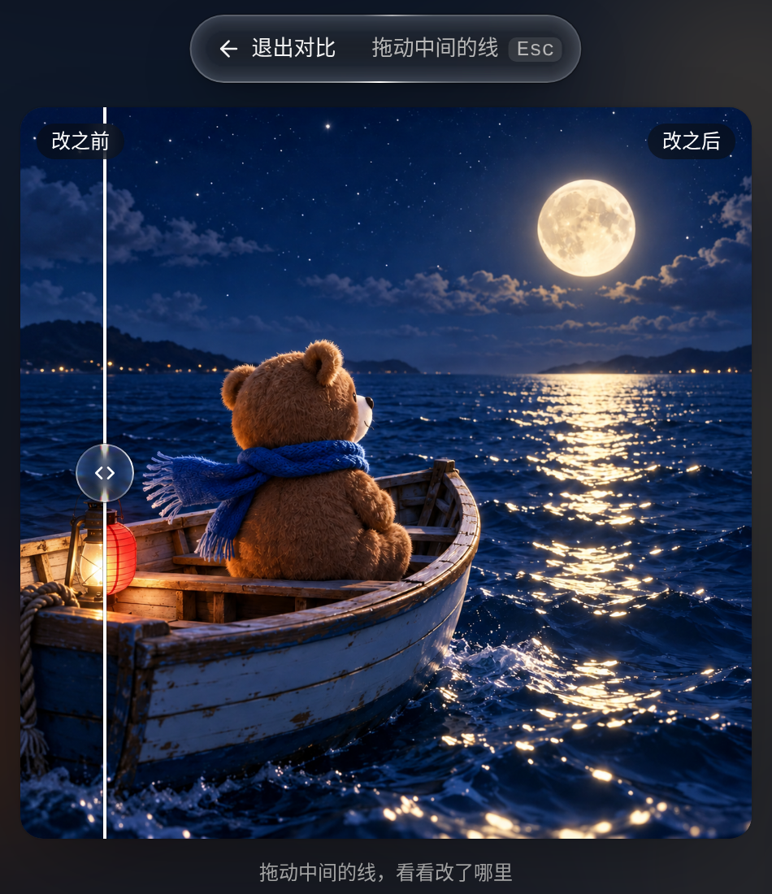
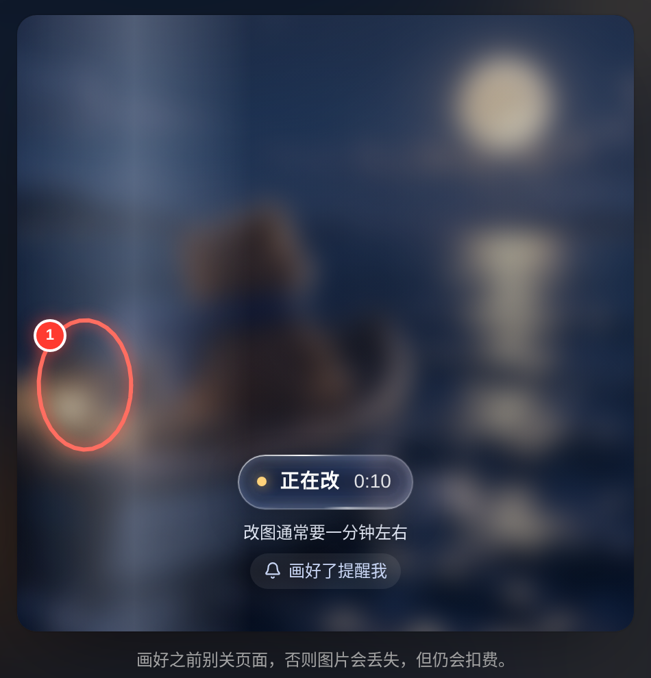

import { Aside, Steps } from '@astrojs/starlight/components'

在控制台的 **画图** 页，用一句话描述画面就能出图。不满意可以接着说怎么改，也可以圈出一块只改那里。费用从账户余额扣除，不需要自己配置 API 密钥。

画图页只使用 5 个 gpt-image 模型。要使用 Gemini 图片模型，或在自己的程序里生成图片，详见 [图片生成](/docs/images/)。

## 画第一张图

<Steps>

1. **打开画图页**

   登录后，点击侧边栏的 **画图**，或直接打开 [画图](/draw)。

2. **描述画面**

   在输入框里描述画面，按 Enter 发送。没想好画什么，可以点击输入框下方的灵感按钮，或按 Tab 填入输入框里的灰色示例，改几个字再发送。

3. **等待出图**

   等 20 到 40 秒，图片会出现在右侧的画布上。

</Steps>

发送前，可以用输入框下方的按钮设置这张图：

- **比例** — 自动（默认）、方形、横版或竖版。方形 1254×1254，横版 1672×941，竖版 941×1672，自动由模型决定
- **透明背景** — 生成透明背景的 PNG，约 $0.062 一张，是最贵的选项。默认关闭
- **模型** — Sunburst 2.6（默认）、Flare 2.6、Sunburst 2.5、Flare 2.5 或 Image 2，单价相同。Sunburst 2.6 是最新一代；Flare 由 OpenAI 定位为速度优先；Sunburst 2.5 和 Image 2 是上一代

输入框右下角是这张图的预估价。最多可以同时画 3 张。

第一次画图时，页面会自动创建一个名为 **网页画图** 的 API 密钥，你可以在 [API 密钥](/keys) 页看到它。它只能用来画图，费用从账户余额扣除。不要修改它的状态、额度和过期时间；出了问题就删掉它，下次画图时页面会自动重建。

## 接着改

画好后，图片下方显示模型、用时和费用，再往下是 3 条以 **↳** 开头的建议。点击一条建议会把它填进输入框，不会直接发送。

输入框里有 **改这张** 时，你写的描述会用来修改画布上的这张图。先说要改什么，最后加一句 `其他保持不变`，改动会更小。

想画一张新图，点击 **改这张** 右上角的 ×，再发送。新图仍在这个对话里。

也可以使用你自己的图片：

- 点击输入框左侧的 **+** 上传图片，或把图片拖进输入框、按 Ctrl+V 粘贴。支持 PNG、JPG 和 WebP，最多 4 张。
- 点击 **+**，选择 **从这个对话里选**，把之前画的图当作参考图。

在对话或画布里右键点击一张图，可以接着改、当作参考图、下载、复制或全屏查看。

## 圈选改图

<Steps>

1. **进入圈选**

   点击画布上方的 **圈选**。

2. **圈出要改的地方**

   在图上圈出要改的地方，可以圈多处。圈错了，点击撤销或清空。

   

   

   

3. **完成圈选**

   点击 **完成**。输入框里会出现两张图：要改的图（图 1）和圈出的地方（图 2）。

4. **描述改法并发送**

   写清楚圈里的地方怎么改，然后发送。

   

   

   

</Steps>

圈出的地方会作为第二张图上传，所以圈选改图比普通改图多约 $0.012。

<Aside title="圈选只是大致范围">
模型会按圈出的位置重画整张图，圈外的地方偶尔也会有细微变化。
</Aside>

## 对比与再画一张

改图后，点击画布上方的 **对比**，拖动中间的分割线查看改了哪里。按 Esc 退出。

点击 **再画一张**，会用同样的描述和设置再画一张。原图保留，新图另外扣费。

工具栏右侧的 3 个图标分别是复制描述、下载和全屏。

## 等待与提醒

一张图通常要 20 到 40 秒，改图要 1 分钟左右。

<Aside type="caution" title="画好之前别关页面">
页面关闭或刷新后，这张图会丢失，但仍然会扣费。正在画时关闭页面，浏览器会先弹出确认框。
</Aside>

想切到别的标签页等待，点击 **画好了提醒我** 或对话里的铃铛图标，打开提醒：

- **系统通知** — 画好后弹出系统通知。第一次打开时，浏览器会询问是否允许。手机浏览器不支持
- **提示音** — 画好后响一声，默认打开

页面在前台时不提醒。画图期间，标签页标题会显示用时，画好后变成 **✓ 画好了**。

## 对话保存

对话和图片只保存在当前浏览器中，换设备、换浏览器或清除浏览器数据后会消失。想保留的图片请下载下来。

点击对话顶部的对话名，可以搜索、重命名和删除对话。

## 计费

画图和调用图片接口的计费方式相同：按实际用量从账户余额扣费，单价详见 [模型广场](/pricing) 和 [图片生成](/docs/images/)。

- 输入框里显示的是预估价，实际按这次的真实用量扣费，画好后显示在图片下方，两者会有出入。改图出入最大，实际扣费可能不到预估价的一半，也可能是它的两倍多。
- 失败的请求不扣费。已经发出的请求，关闭页面后仍然扣费。
- **↳** 建议由一个便宜的对话模型（目前是 `gemini-3.1-flash-lite`）生成，每次约 $0.0001，[使用日志](/usage-logs/common) 里会多一条记录。

实测费用（2026 年 10 月）：

| 操作 | 预估价 | 实际扣费 |
| --- | --- | --- |
| 画一张图（自动比例） | $0.011 | $0.0105 |
| 圈选改图 | $0.066 | $0.029 |
| 画一张透明背景的图 | $0.062 | 约 $0.062 |

余额低于 1 美元时，输入框上方会提示余额还够画几张。余额不够画下一张时，页面不会发送。

## 在手机上使用

- 对话占满屏幕。发送后画布全屏打开，点击左上角的 **←** 回到对话。
- 圈选可以直接用手指画。
- 手机浏览器不弹出系统通知，画图时请停留在画图页等待。
- iPhone 上的 Safari 可能清除很久没打开的网站的数据，想保留的图片请及时下载。

## 出错处理

画图失败时，对话里会显示一张出错卡片。除了画到一半关闭页面，失败都不扣费。

| 卡片标题 | 处理方式 |
| --- | --- |
| 这张没有画出来 | 点击 **重试**。卡片下方附有上游的报错原文 |
| 这段描述没有通过内容审核 | 点击 **修改描述**，换一种说法。规则详见 [图片生成](/docs/images/) |
| 服务器繁忙，这次没有画出来 | 点击 **重试**。透明背景和改图经常这样失败时，详见下方的 [常见问题](#常见问题) |
| 余额不够画这一张 | 点击 **充值**，充值后再画 |
| 画图令牌用不了 | **网页画图** 密钥被停用、过期或额度用完。到 [API 密钥](/keys) 页删掉它，再点击 **重试**，页面会新建一个 |
| 页面关闭时这张还没画完 | 点击 **再画一次**。原来那张没能保存，但可能已经扣费 |

## 常见问题

### 透明背景或改图经常失败？

画图请求超过 100 秒没有返回会被断开，透明背景和改图偶尔会接近这个时间。失败后点击 **再画一次**。

### 打开系统通知后没有弹出通知？

在浏览器的网站设置里允许通知。手机浏览器不支持系统通知。

### 换了浏览器后对话不见了？

对话只保存在原来的浏览器里，请回到原来的浏览器查看。
