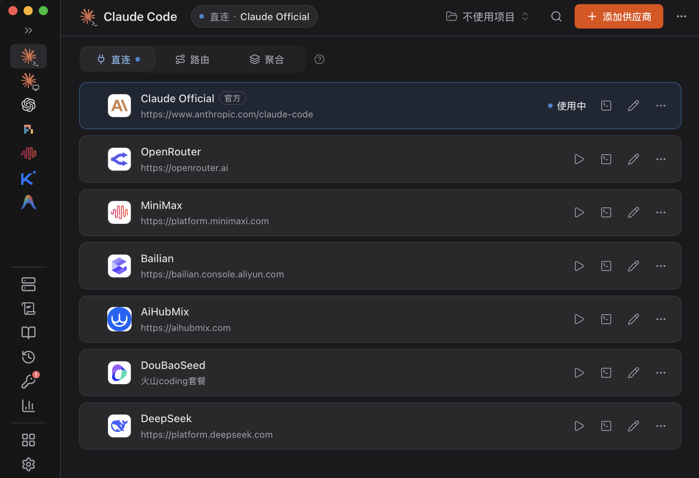

import { Aside, Steps } from '@astrojs/starlight/components'

本页介绍 CC Switch 的安装和界面。各工具的具体配置步骤见对应的工具页。

## 概述

[CC Switch](https://github.com/farion1231/cc-switch) 是一款桌面应用，用于管理 Claude Code、Codex 和 Gemini CLI 等编码工具的 API 供应商。把小熊API 添加为供应商后，点击一次即可切换，无需手动修改配置文件。

如果你同时使用多个编码工具，或经常在小熊API 和官方账号之间切换，CC Switch 可以在一个界面中管理所有配置。本页界面文字以 CC Switch 4.0.21 为准。

## 前置条件

- **小熊API 密钥** — 在控制台的 [API 密钥](/keys) 页创建。
- **有图形界面的电脑** — Windows 10、macOS 12 或更新的系统，或 Ubuntu 22.04、Debian 12 等较新的 Linux。没有图形界面的服务器请按各工具页的手动配置操作。
- **CC Switch 4.0.10 或更新版本** — 旧版本不支持从控制台一键导入。

## 安装 CC Switch

<Steps>

1. **下载安装包**

   在 [CC Switch 发布页](https://github.com/farion1231/cc-switch/releases) 最新版本的 **Assets** 中下载对应的安装包：

   | 系统 | 安装包 |
   | --- | --- |
   | Windows | 以 `-Windows.msi` 结尾；ARM 电脑选 `-Windows-arm64.msi` |
   | macOS | 以 `-macOS.dmg` 结尾，Apple 芯片和 Intel 芯片通用 |
   | Linux | Debian / Ubuntu 选 `.deb`，Fedora 选 `.rpm`，其他发行版选 `.AppImage` |

   macOS 也可以用 Homebrew 安装，装好后直接启动：

   ```bash
   brew install --cask cc-switch
   ```

2. **运行安装程序**

   Windows 双击 `.msi`，按向导使用默认设置完成安装。如果弹出 **Windows 已保护你的电脑**，点击 **更多信息**，再点击 **仍要运行**。macOS 打开 `.dmg`，把 CC Switch 拖进 **应用程序** 文件夹。

3. **启动 CC Switch**

   启动后会看到下面的主界面。图中左侧选中的是 Claude Code，中间是它的供应商列表。

   

   首次启动时，CC Switch 会把各工具原有的配置保存为名为 `default` 的供应商，原配置不会丢失。

</Steps>

## 界面概览

- **侧栏** — 左侧一列图标，每个图标对应一个编码工具。点击后右侧显示该工具的供应商，页面标题也随之变化。
- **添加供应商** — 右上角的橙色按钮，为当前工具添加供应商。
- **直连 / 路由 / 聚合** — 使用小熊API 时选 **直连**。直连模式下 CC Switch 只修改工具的配置文件，请求不经过它，因此不需要一直开着。
- **供应商列表** — 每张卡片是一个供应商，正在使用的卡片显示 **使用中**。点击其他卡片右侧的 ▷ 即可切换；铅笔图标用于编辑，**⋯** 菜单中有 **删除**。

### 一般操作流程

1. 在侧栏点击要配置的工具。
2. 添加小熊API 供应商：在控制台的 [API 密钥](/keys) 页一键导入（推荐），或点击 **添加供应商** → **自定义配置** 手动填写。具体步骤见各工具页。
3. 在小熊API 卡片上点击 ▷ 切换。一键导入默认已经切换，可跳过这一步。
4. 重新运行工具。Claude Code 无需重启；Codex 和 Gemini CLI 需要退出后重新运行。

<Aside type="caution" title="密钥会写进配置文件">
CC Switch 会把密钥写入各工具在用户目录下的配置文件，例如 `~/.claude/settings.json`。不要把这些文件提交到仓库或发给别人。CC Switch 首次改写配置文件前，会把原文件备份到 `~/.cc-switch/backups/live-first-write/`。
</Aside>

## 常见问题

| 现象 | 原因 | 解决办法 |
| --- | --- | --- |
| 在控制台点击 **打开 CC Switch** 后没有反应 | 没有安装 CC Switch 或版本低于 4.0.10，浏览器通常不会提示 | 安装 4.0.10 以上版本后重试，或在 CC Switch 中手动添加 |
| 列表里有两张小熊API 卡片 | 同一个密钥导入了两次，CC Switch 不会合并重复的卡片 | 在多余卡片的 **⋯** 菜单中选择 **删除** |
| 切换后工具仍在用原来的配置 | 切换后没有重新运行工具 | 退出工具，在新终端中重新运行 |
| `401` 或 `Invalid token` | 密钥错误或已失效 | 详见 [错误码](/docs/errors/) |
| 连接失败或一直重试 | 当前线路无法连接，控制台导入的是主线路 | 点击卡片上的铅笔图标，把地址中的域名换成其他 [线路](/docs/lines/) |

CC Switch 的完整用法请参阅它的 [用户手册](https://github.com/farion1231/cc-switch/blob/main/docs/user-manual/zh/README.md)。

## 下一步

- [Claude Code](/docs/tools/claude-code/#用-cc-switch-配置) — 用 Claude 或 GPT 模型写代码
- [Codex](/docs/tools/codex/#用-cc-switch-配置) — 用 GPT 模型写代码
- [Gemini CLI](/docs/tools/gemini-cli/#用-cc-switch-配置) — 用 Gemini 模型写代码
