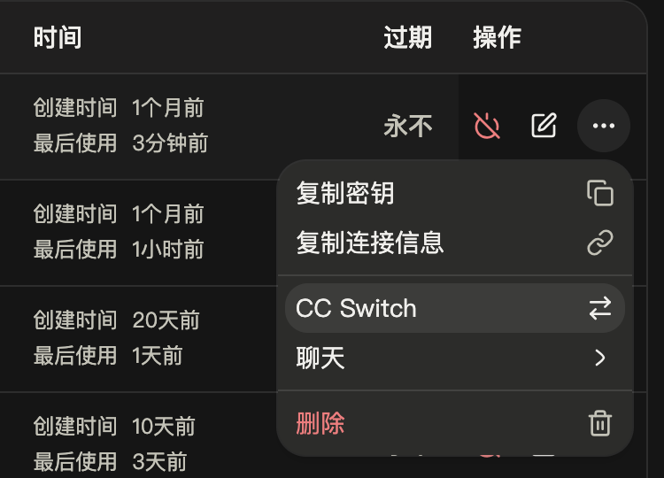
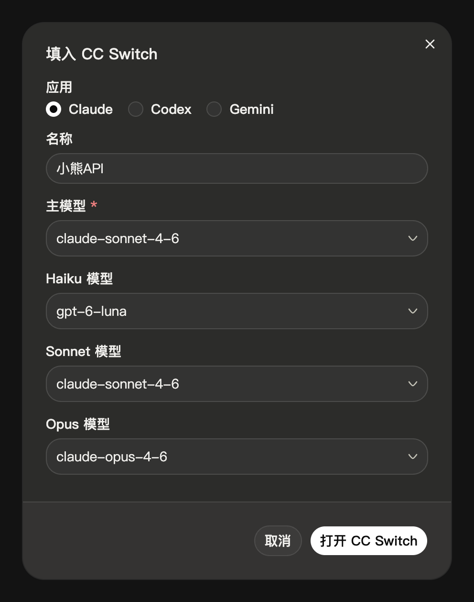
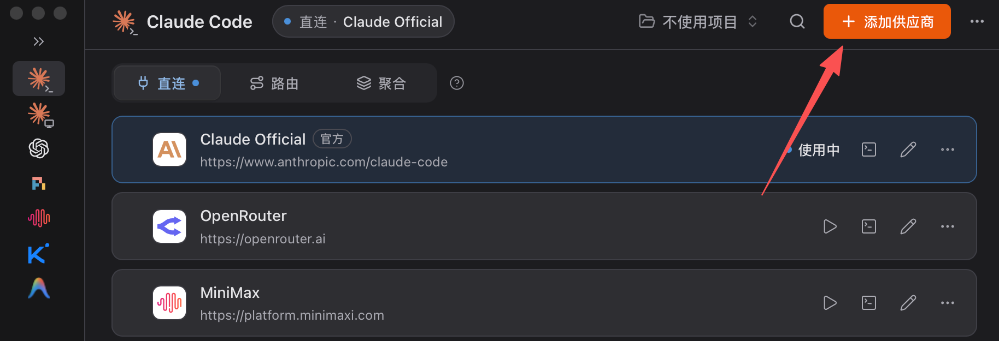
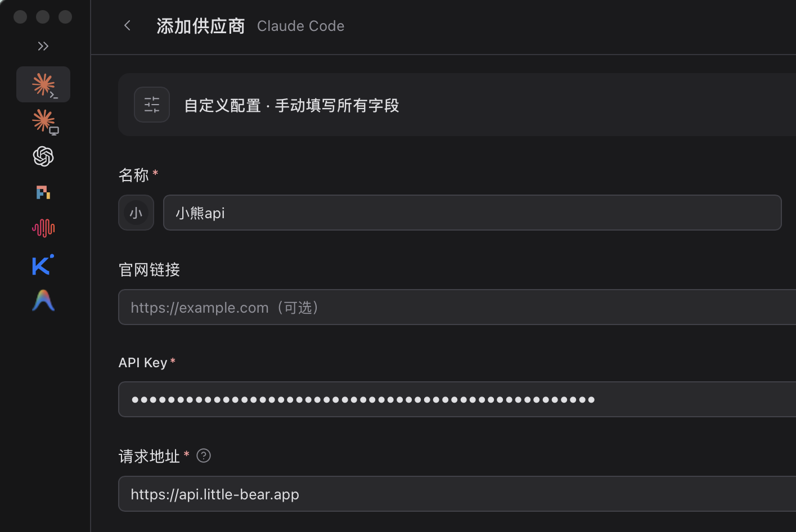
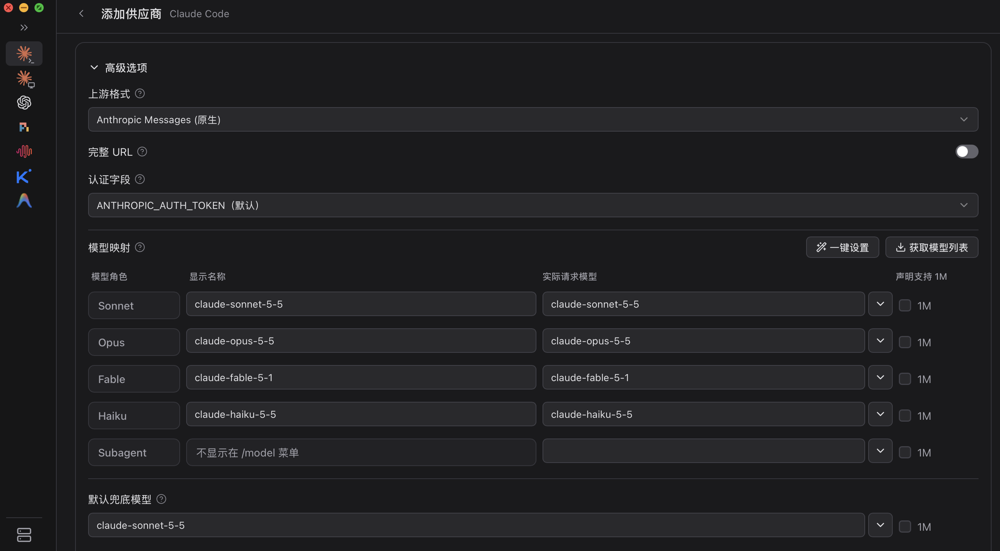

import { Aside, Steps, TabItem, Tabs } from '@astrojs/starlight/components'

配置 Claude Code 使用小熊API。你可以用 CC Switch 一键导入，也可以手动编辑配置文件。

## 概述

Claude Code 是 Anthropic 推出的终端编程助手，可以读写项目文件、执行命令。接入小熊API 只需设置地址和密钥，并把 Claude Code 默认的模型名换成小熊API 的模型名。

Claude Code 通过 [Claude 格式](/docs/claude/) 发送请求。Claude 模型和 GPT 模型都能用：选 GPT 模型时，小熊API 会把请求转换成 GPT 模型的调用。不需要 Claude 账号或 Anthropic 的 API Key。

## 前置条件

- **小熊API 密钥** — 在控制台的 [API 密钥](/keys) 页创建。
- **CC Switch**（可选）— 一键导入时需要，安装方法详见 [CC Switch 配置](/docs/tools/cc-switch/)。

## 安装 Claude Code

<Tabs syncKey="os">
<TabItem label="macOS / Linux">

```bash
curl -fsSL https://claude.ai/install.sh | bash
```

</TabItem>
<TabItem label="Windows">

```powershell
irm https://claude.ai/install.ps1 | iex
```

建议同时安装 [Git for Windows](https://git-scm.com/downloads/win)，Claude Code 会用它执行命令。

</TabItem>
</Tabs>

上面的地址打不开时，可以用 npm 安装（需要 Node.js 22 以上）：`npm install -g @anthropic-ai/claude-code`。

安装后打开一个新终端，运行 `claude --version`，输出版本号即安装成功。

## 用 CC Switch 配置

### 控制台一键导入

<Steps>

1. **打开导入窗口**

   在控制台的 [API 密钥](/keys) 页，点击要用的密钥右侧的 **⋯**，选择 **CC Switch**。

   <div class="shot" style="--w: 375px">

   

   </div>

2. **选择应用和模型**

   **应用** 选 **Claude**，**名称** 改为 `小熊API`，模型按下表填写（可以从列表中选，也可以直接输入）：

   | 字段 | 填写 |
   | --- | --- |
   | 主模型 | `claude-sonnet-4-6` |
   | Haiku 模型 | `gpt-6-luna` |
   | Sonnet 模型 | `claude-sonnet-4-6` |
   | Opus 模型 | `claude-opus-4-6` |

   **Haiku 模型** 不要留空。Claude Code 的后台小任务用它，留空时会使用 Claude Code 自带的 Haiku 模型名，小熊API 上不一定有。这里填便宜的 `gpt-6-luna`。

   <div class="shot" style="--w: 496px">

   

   </div>

3. **导入**

   点击 **打开 CC Switch**，浏览器询问时允许打开。CC Switch 弹出 **确认导入供应商配置** 窗口后，确认 **API 端点** 为 `https://api.little-bear.app`，保持底部的 **导入后立即切换到这个供应商** 开启，点击 **导入**。

</Steps>

导入后按 [验证](#验证) 测试。之后在 CC Switch 中切换供应商，Claude Code 无需重启。

### 手动添加

控制台导入无法打开 CC Switch 时，在 CC Switch 中手动添加。

<Steps>

1. **添加供应商**

   在侧栏点击 Claude Code，再点击右上角的 **添加供应商**。

   

2. **填写名称、密钥和地址**

   选择 **自定义配置**，按下表填写：

   | 字段 | 填写 |
   | --- | --- |
   | 名称 | `小熊API` |
   | API Key | 你的密钥，以 `sk-` 开头 |
   | 请求地址 | `https://api.little-bear.app` |

   <div class="shot" style="--w: 708px">

   

   </div>

3. **填写模型**

   向下滚动，展开 **高级选项**。在 **模型映射** 中按角色填写模型，**显示名称** 和 **实际请求模型** 填同一个模型名：

   | 角色 | 模型 |
   | --- | --- |
   | Sonnet | `claude-sonnet-5-5` |
   | Opus | `claude-opus-5-5` |
   | Fable | `claude-fable-5-1` |
   | Haiku | `claude-haiku-5-5` |
   | Subagent | 留空 |

   **默认兜底模型** 填 `claude-sonnet-5-5`，这是 Claude Code 启动时使用的模型。

   如果想和一键导入使用相同的模型：Sonnet 和 **默认兜底模型** 填 `claude-sonnet-4-6`，Opus 填 `claude-opus-4-6`，Haiku 填 `gpt-6-luna`。

   

4. **保存并切换**

   点击页面底部的 **添加**，再点击小熊API 卡片上的 ▷ 切换，然后按 [验证](#验证) 测试。

</Steps>

## 手动配置

不使用 CC Switch（例如在服务器上）时，直接编辑 Claude Code 的用户配置文件，没有就新建一个：

| 系统 | 路径 |
| --- | --- |
| macOS / Linux | `~/.claude/settings.json` |
| Windows | `%USERPROFILE%\.claude\settings.json` |

写入下面的内容，把 `sk-你的密钥` 换成你的密钥。两种写法任选其一，不确定时用 Claude 模型：

<Tabs syncKey="cc-model">
<TabItem label="用 Claude 模型">

```json title="settings.json"
{
  "env": {
    "ANTHROPIC_BASE_URL": "https://api.little-bear.app",
    "ANTHROPIC_AUTH_TOKEN": "sk-你的密钥",
    "ANTHROPIC_MODEL": "claude-sonnet-4-6",
    "ANTHROPIC_DEFAULT_OPUS_MODEL": "claude-opus-4-6",
    "ANTHROPIC_DEFAULT_SONNET_MODEL": "claude-sonnet-4-6",
    "ANTHROPIC_DEFAULT_HAIKU_MODEL": "gpt-6-luna",
    "CLAUDE_CODE_SUBAGENT_MODEL": "claude-sonnet-4-6",
    "CLAUDE_CODE_DISABLE_NONESSENTIAL_TRAFFIC": "1"
  }
}
```

</TabItem>
<TabItem label="用 GPT 模型">

```json title="settings.json"
{
  "env": {
    "ANTHROPIC_BASE_URL": "https://api.little-bear.app",
    "ANTHROPIC_AUTH_TOKEN": "sk-你的密钥",
    "ANTHROPIC_MODEL": "gpt-6.1-sol",
    "ANTHROPIC_DEFAULT_OPUS_MODEL": "gpt-6-astra",
    "ANTHROPIC_DEFAULT_SONNET_MODEL": "gpt-6.1-sol",
    "ANTHROPIC_DEFAULT_HAIKU_MODEL": "gpt-6-luna",
    "CLAUDE_CODE_SUBAGENT_MODEL": "gpt-6.1-sol",
    "CLAUDE_CODE_DISABLE_NONESSENTIAL_TRAFFIC": "1"
  }
}
```

</TabItem>
</Tabs>

文件中原来有内容的话，把这几行合并到已有的 `env` 中，不要写两个 `env`。

<Aside type="caution" title="密钥只写在用户配置里">
不要把密钥写进项目目录下的 `.claude/settings.json`。这个文件通常会提交到仓库，别人克隆项目就能看到你的密钥。
</Aside>

### 配置项说明

| 变量 | 含义 |
| --- | --- |
| `ANTHROPIC_BASE_URL` | 小熊API 的地址，**不带** `/v1`，Claude Code 会自己拼接。换线路时只改域名 |
| `ANTHROPIC_AUTH_TOKEN` | 你的密钥，以 `Authorization: Bearer` 请求头发送 |
| `ANTHROPIC_MODEL` | 默认模型 |
| `ANTHROPIC_DEFAULT_OPUS_MODEL` | 在 `/model` 中选 Opus 时实际使用的模型 |
| `ANTHROPIC_DEFAULT_SONNET_MODEL` | 选 Sonnet 时实际使用的模型 |
| `ANTHROPIC_DEFAULT_HAIKU_MODEL` | 选 Haiku 时使用的模型，也用于生成会话标题等后台小任务，建议用便宜的 `gpt-6-luna` |
| `CLAUDE_CODE_SUBAGENT_MODEL` | 子代理使用的模型 |
| `CLAUDE_CODE_DISABLE_NONESSENTIAL_TRAFFIC` | 关闭发往 Anthropic 的统计、错误上报等请求，使用小熊API 时用不到 |

模型名可以换成 [模型广场](/pricing) 中的任意模型，Claude、GPT 和 Gemini 模型可以混用。想省钱，把几个模型变量都改成 `gpt-6-luna`。

## 验证

进入项目目录，运行 `claude` 并发送一句话，然后输入：

```text
/status
```

`Anthropic base URL` 一行显示 `https://api.little-bear.app`，说明请求已经通过小熊API。

## 常见问题

| 现象 | 原因 | 解决办法 |
| --- | --- | --- |
| 启动后要求登录 Claude 账号 | Claude Code 没有读到密钥 | 检查 `~/.claude/settings.json` 的 JSON 格式，确认 `ANTHROPIC_AUTH_TOKEN` 写在 `env` 中 |
| 启动时提示有两个登录来源，`auth may not work as expected` | 之前登录过 Claude 账号，与密钥冲突 | 在 Claude Code 中运行 `/logout` 退出 Claude 账号 |
| `401` 或 `Invalid token` | 密钥错误或已失效 | 详见 [错误码](/docs/errors/) |
| `No available channel for model …` | 有模型变量没改，Claude Code 还在用自带的模型名，例如 Haiku 模型 | 确认各模型变量都填了 [模型广场](/pricing) 中的名字 |
| `400` 错误中提到 `Extra inputs are not permitted` 或其他不认识的字段 | Claude Code 发送了实验性字段 | 在 `env` 中加入 `"CLAUDE_CODE_DISABLE_EXPERIMENTAL_BETAS": "1"` |
| `/status` 中看不到 `https://api.little-bear.app` | 配置没有生效 | 确认改的是用户目录下的 `settings.json`，然后重新启动 `claude` |

更多环境变量和报错请参阅 Claude Code 官方的 [LLM 网关文档](https://code.claude.com/docs/zh-CN/llm-gateway-connect)。

## 下一步

- [Claude 格式](/docs/claude/) — Claude Code 使用的接口格式
- [可用模型](/docs/models/) — 选择适合写代码的模型
- [线路选择](/docs/lines/) — 连接不稳定时更换线路
