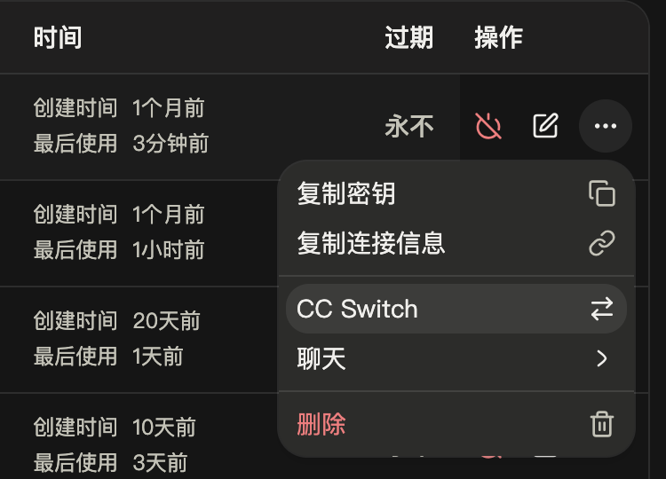
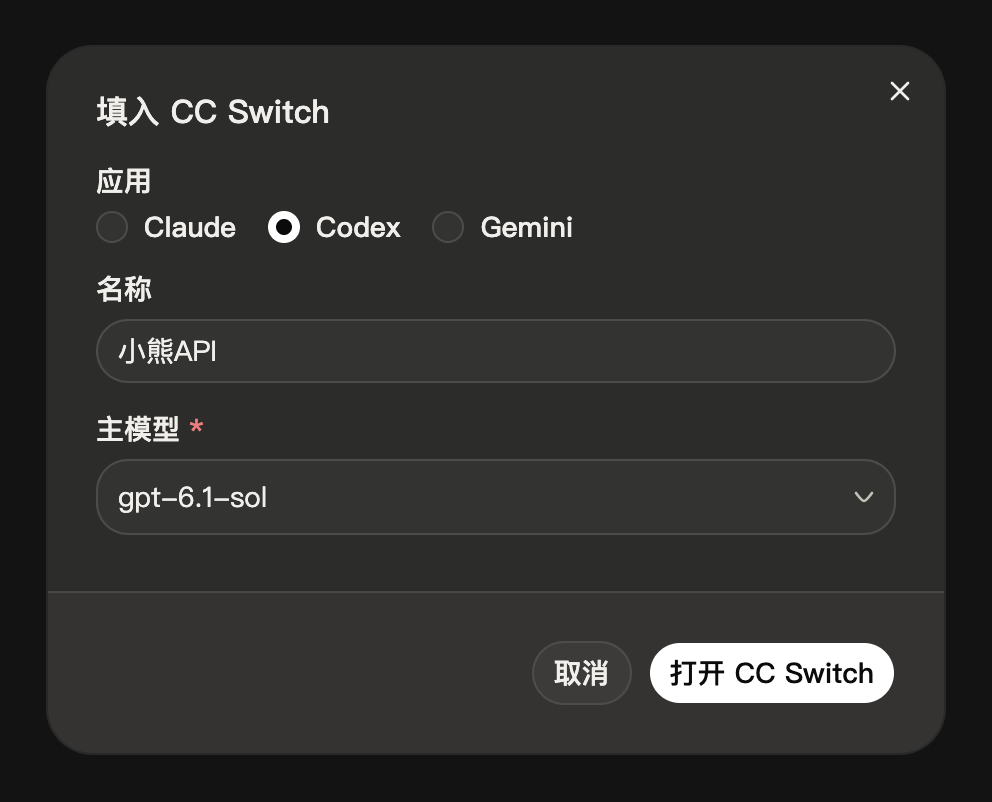

import { Aside, Steps, TabItem, Tabs } from '@astrojs/starlight/components'

配置 Codex 命令行版本使用小熊API。你可以用 CC Switch 一键导入，也可以手动编辑配置文件。

## 概述

Codex 是 OpenAI 推出的编程助手，可以读写项目文件、执行命令，接入后不需要 ChatGPT 账号。它只通过 [OpenAI 格式](/docs/openai/) 的 Responses 接口调用模型，使用小熊API 的 GPT 模型：写代码推荐 `gpt-6.1-sol`，想省钱用 `gpt-6-luna`。

## 前置条件

- **小熊API 密钥** — 在控制台的 [API 密钥](/keys) 页创建。
- **Node.js 16 以上** — 用 npm 安装时需要。
- **CC Switch**（可选）— 一键导入时需要，安装方法详见 [CC Switch 配置](/docs/tools/cc-switch/)。

## 安装 Codex

```bash
npm install -g @openai/codex
```

安装后运行 `codex --version`，输出版本号即安装成功。

## 用 CC Switch 配置

使用 CC Switch 时，密钥由 CC Switch 写入 Codex 的配置，不需要再设置 [手动配置](#手动配置) 中的环境变量。

### 控制台一键导入

<Steps>

1. **打开导入窗口**

   在控制台的 [API 密钥](/keys) 页，点击要用的密钥右侧的 **⋯**，选择 **CC Switch**。

   <div class="shot" style="--w: 375px">

   

   </div>

2. **选择应用和模型**

   **应用** 选 **Codex**，**名称** 改为 `小熊API`，**主模型** 填 `gpt-6.1-sol`。想省钱可以改为 `gpt-6-luna`。

   <div class="shot" style="--w: 496px">

   

   </div>

3. **导入**

   点击 **打开 CC Switch**，浏览器询问时允许打开。CC Switch 弹出 **确认导入供应商配置** 窗口后，确认 **API 端点** 为 `https://api.little-bear.app/v1`，保持底部的 **导入后立即切换到这个供应商** 开启，点击 **导入**。

</Steps>

导入后退出正在运行的 Codex，在新终端中按 [验证](#验证) 测试。

### 手动添加

控制台导入无法打开 CC Switch 时，在侧栏点击 Codex，点击 **添加供应商**，选择 **自定义配置**，按下表填写，**模型列表** 留空。然后点击页面底部的 **添加**，再点击小熊API 卡片上的 ▷ 切换。

| 字段 | 填写 |
| --- | --- |
| 名称 | `小熊API` |
| API Key | 你的密钥，以 `sk-` 开头 |
| API 请求地址 | `https://api.little-bear.app/v1` |
| 默认模型 | `gpt-6.1-sol` |

## 手动配置

不使用 CC Switch（例如在服务器上）时，用环境变量和配置文件接入。

<Steps>

1. **把密钥存入环境变量**

   <Tabs syncKey="os">
   <TabItem label="macOS / Linux">

   ```bash
   echo 'export XIAOXIONG_API_KEY="sk-你的密钥"' >> ~/.zshrc
   source ~/.zshrc
   ```

   使用 bash 时，把 `~/.zshrc` 换成 `~/.bashrc`。

   </TabItem>
   <TabItem label="Windows">

   ```powershell
   setx XIAOXIONG_API_KEY "sk-你的密钥"
   ```

   执行后关闭终端，之后的步骤在新终端中进行。

   </TabItem>
   </Tabs>

2. **编辑配置文件**

   打开 Codex 的配置文件，没有就新建一个：

   | 系统 | 路径 |
   | --- | --- |
   | macOS / Linux | `~/.codex/config.toml` |
   | Windows | `%USERPROFILE%\.codex\config.toml` |

   把下面的内容放在文件最前面：

   ```toml title="config.toml"
   model = "gpt-6.1-sol"
   model_provider = "xiaoxiong"

   [model_providers.xiaoxiong]
   name = "小熊API"
   base_url = "https://api.little-bear.app/v1"
   env_key = "XIAOXIONG_API_KEY"
   wire_api = "responses"
   ```

   `model` 和 `model_provider` 必须写在第一个 `[...]` 段落之前，写在后面 Codex 读不到。文件中已有这两行时直接修改，不要重复写。

</Steps>

### 配置项说明

| 配置 | 含义 |
| --- | --- |
| `model` | 默认模型。会话中用 `/model` 可以临时切换 |
| `model_provider` | 使用的服务商，对应 `[model_providers.xiaoxiong]` 中的名字 |
| `base_url` | 小熊API 的地址，要带 `/v1`。换线路时只改域名 |
| `env_key` | 从哪个环境变量读取密钥 |
| `wire_api` | 固定为 `responses`，Codex 只支持这一种 |

<Aside type="caution" title="别把密钥直接写进配置文件">
配置文件经常被同步或分享。用 `env_key` 从环境变量读取密钥，配置文件中就不会出现密钥。
</Aside>

## 验证

```bash
codex exec "Reply with exactly: gateway-ok"
```

输出最后打印 `gateway-ok`，说明接入成功。手动配置时，开头的信息中还会显示 `model: gpt-6.1-sol` 和 `provider: xiaoxiong`。

之后进入项目目录运行 `codex` 即可使用，在对话中输入 `/status` 可以查看当前的模型和服务商。

## 常见问题

| 报错 | 原因 | 解决办法 |
| --- | --- | --- |
| `Missing environment variable: XIAOXIONG_API_KEY` | Codex 读不到环境变量 | Windows 用 `setx` 后要重开终端；macOS / Linux 确认改的是自己 shell 的配置文件，然后重开终端 |
| `unexpected status 401 Unauthorized: Invalid token` | 密钥错误或已失效 | 详见 [错误码](/docs/errors/) |
| `unexpected status 503 Service Unavailable: No available channel for model …` | 小熊API 没有这个模型 | 把 `model` 改成 [模型广场](/pricing) 中的名字，例如 `gpt-6.1-sol` |
| 开头显示的 `provider` 不是 `xiaoxiong` | `model_provider` 没有生效 | 确认这两行在文件最前面，第一个 `[...]` 之前 |
| 反复出现 `Reconnecting... 1/5` 后报连接错误 | 当前线路无法连接。报错前出现几次 `Reconnecting...` 是 Codex 在自动重试，属于正常现象 | 换一条 [线路](/docs/lines/)，修改 `base_url` 的域名 |
| 让 Codex 生成图片，没有得到图片 | GPT 对话模型不生成图片 | 改用图片接口，详见 [图片生成](/docs/images/) |

## 下一步

- [OpenAI 格式](/docs/openai/) — Codex 使用的 Responses 接口
- [可用模型](/docs/models/) — 选择适合写代码的模型
- [线路选择](/docs/lines/) — 连接不稳定时更换线路
