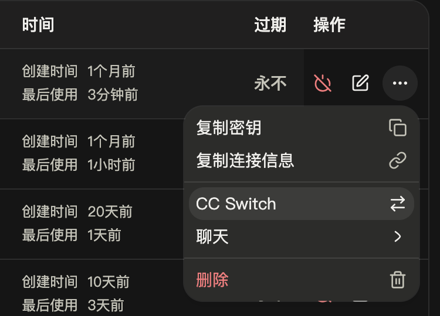
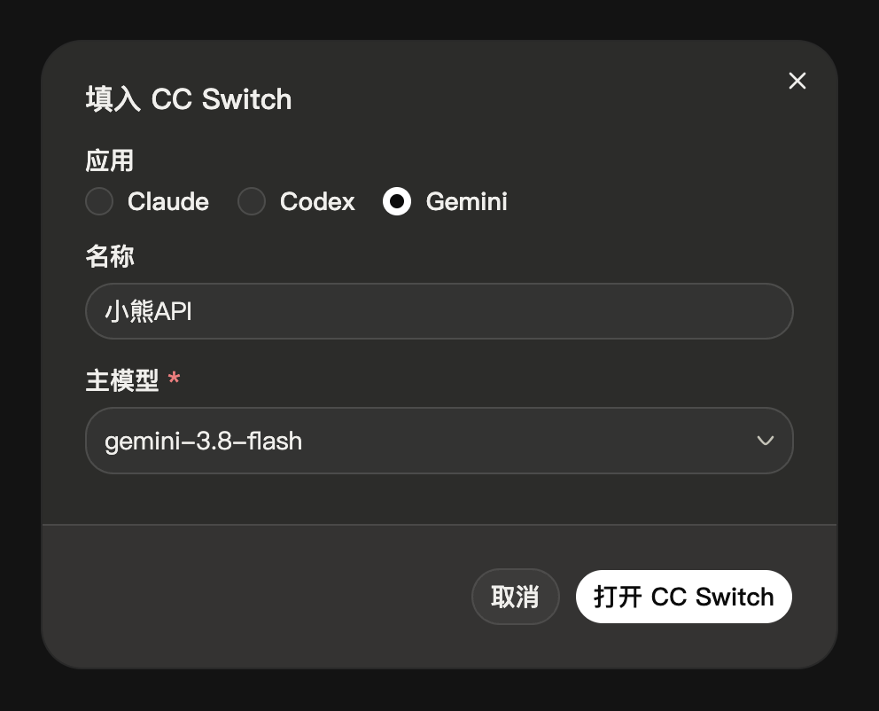

import { Aside, Steps } from '@astrojs/starlight/components'

配置 Gemini CLI 使用小熊API。你可以用 CC Switch 一键导入，也可以手动编辑配置文件。

## 概述

Gemini CLI 是 Google 推出的终端编程助手，可以读写项目文件、执行命令。它通过 [Gemini 格式](/docs/gemini/) 调用小熊API 的 Gemini 模型，接入后不需要 Google 账号。

推荐使用 `gemini-3.8-flash`；想快一些、便宜一些，用 `gemini-3-flash`。本页配置以 Gemini CLI 0.46 为准。

## 前置条件

- **小熊API 密钥** — 在控制台的 [API 密钥](/keys) 页创建。
- **Node.js 20 以上** — 用 npm 安装时需要。
- **CC Switch**（可选）— 一键导入时需要，安装方法详见 [CC Switch 配置](/docs/tools/cc-switch/)。

## 安装 Gemini CLI

```bash
npm install -g @google/gemini-cli
```

macOS 也可以用 Homebrew 安装：`brew install gemini-cli`。

安装后运行 `gemini --version`，输出版本号即安装成功。

## 用 CC Switch 配置

### 控制台一键导入

<Steps>

1. **打开导入窗口**

   在控制台的 [API 密钥](/keys) 页，点击要用的密钥右侧的 **⋯**，选择 **CC Switch**。

   <div class="shot" style="--w: 375px">

   

   </div>

2. **选择应用和模型**

   **应用** 选 **Gemini**，**名称** 改为 `小熊API`，**主模型** 填 `gemini-3.8-flash`。

   <div class="shot" style="--w: 496px">

   

   </div>

3. **导入**

   点击 **打开 CC Switch**，浏览器询问时允许打开。CC Switch 弹出 **确认导入供应商配置** 窗口后，确认 **API 端点** 为 `https://api.little-bear.app`，保持底部的 **导入后立即切换到这个供应商** 开启，点击 **导入**。

4. **开启动态模型配置**

   CC Switch 只修改地址、密钥、模型名和登录方式。你还需要在 Gemini CLI 的 `settings.json`（macOS / Linux 为 `~/.gemini/settings.json`，Windows 为 `%USERPROFILE%\.gemini\settings.json`）中加入下面一项，没有这个文件就新建一个：

   ```json title="settings.json"
   {
     "experimental": { "dynamicModelConfiguration": true }
   }
   ```

   文件中原来有内容的话，把这一项合并进去。不加的话，Gemini CLI 会把模型换成小熊API 没有的 `gemini-3.5-flash`，请求会一直失败。

</Steps>

完成后退出正在运行的 Gemini CLI，在新终端中按 [验证](#验证) 测试。

### 手动添加

控制台导入无法打开 CC Switch 时，在侧栏点击 Gemini CLI，点击 **添加供应商**，选择 **自定义配置**，按下表填写。然后点击页面底部的 **添加**，再点击小熊API 卡片上的 ▷ 切换。最后同样要完成上面第 4 步的设置。

| 字段 | 填写 |
| --- | --- |
| 名称 | `小熊API` |
| API Key | 你的密钥，以 `sk-` 开头 |
| 请求地址 | `https://api.little-bear.app` |
| 模型 | `gemini-3.8-flash` |

## 手动配置

不使用 CC Switch（例如在服务器上）时，直接编辑 Gemini CLI 的两个配置文件。两个文件都在 Gemini CLI 的配置目录中，没有就新建：

| 系统 | 配置目录 |
| --- | --- |
| macOS / Linux | `~/.gemini/` |
| Windows | `%USERPROFILE%\.gemini\` |

<Steps>

1. **编辑环境变量文件 `.env`**

   写入下面两行，把 `sk-你的密钥` 换成你的密钥：

   ```ini title=".env"
   GEMINI_API_KEY=sk-你的密钥
   GOOGLE_GEMINI_BASE_URL=https://api.little-bear.app
   ```

   地址只填到域名，不带 `/v1beta`。

2. **编辑配置文件 `settings.json`**

   ```json title="settings.json"
   {
     "security": { "auth": { "selectedType": "gemini-api-key" } },
     "model": { "name": "gemini-3.8-flash" },
     "experimental": { "dynamicModelConfiguration": true },
     "privacy": { "usageStatisticsEnabled": false }
   }
   ```

   文件中原来有内容的话，把这几项合并进去，不要写两个同名的项。

</Steps>

<Aside type="caution" title="密钥只写在用户目录里">
不要把密钥写进项目目录下的 `.env` 或 `.gemini/.env`。项目中的文件通常会提交到仓库，别人克隆项目就能看到你的密钥。
</Aside>

### 配置项说明

| 配置项 | 含义 |
| --- | --- |
| `GEMINI_API_KEY` | 你的密钥 |
| `GOOGLE_GEMINI_BASE_URL` | 小熊API 的地址，**不带** `/v1beta`。换线路时只改域名 |
| `security.auth.selectedType` | 设为 `gemini-api-key`，用密钥登录，不使用 Google 账号 |
| `model.name` | 默认模型。想快一些、便宜一些，改成 `gemini-3-flash` |
| `experimental.dynamicModelConfiguration` | 必须设为 `true`。否则 Gemini CLI 会把名字以 `flash` 结尾的模型换成 `gemini-3.5-flash`，小熊API 没有这个模型，请求会一直失败 |
| `privacy.usageStatisticsEnabled` | 关闭发往 Google 的使用统计，使用小熊API 时用不到 |

临时换模型时，启动时加 `-m`，例如 `gemini -m gemini-3-flash`。模型名以 [模型广场](/pricing) 为准。

## 验证

进入项目目录运行 `gemini`。第一次在某个文件夹中运行时，Gemini CLI 会询问是否信任这个文件夹，选择信任。然后发送一句话，能正常回答即接入成功。

文件夹被信任后，也可以不进入界面直接提问：

```bash
gemini -p "用一句话介绍你自己"
```

## 常见问题

| 现象 | 原因 | 解决办法 |
| --- | --- | --- |
| 启动后要求用 Google 账号登录，或报 `Invalid auth method selected.` | `settings.json` 中没有选择用密钥登录 | 按 [手动配置](#手动配置) 第 2 步写入 `"selectedType": "gemini-api-key"`。使用 CC Switch 时，在 CC Switch 中重新切换一次小熊API |
| 一直重试，报 `Attempt 1 failed with status 503` 或 `No available channel for model gemini-3.5-flash` | Gemini CLI 把模型换成了 `gemini-3.5-flash` | 在 `settings.json` 中加入 `"experimental": { "dynamicModelConfiguration": true }` |
| `Gemini CLI is not running in a trusted directory` | 使用 `gemini -p` 时，当前文件夹还没有被信任 | 先在这个文件夹中运行一次 `gemini`，选择信任 |
| `401` 或 `Invalid token` | 密钥错误或已失效 | 详见 [错误码](/docs/errors/) |
| `No available channel for model …` | `model.name` 或 `-m` 中的模型名写错了 | 改成 [模型广场](/pricing) 中的 Gemini 模型名 |

更多配置项请参阅 Gemini CLI 官方的 [配置文档](https://github.com/google-gemini/gemini-cli/blob/main/docs/reference/configuration.md)。

## 下一步

- [Gemini 格式](/docs/gemini/) — Gemini CLI 使用的接口格式
- [可用模型](/docs/models/) — 选择适合写代码的模型
- [线路选择](/docs/lines/) — 连接不稳定时更换线路
